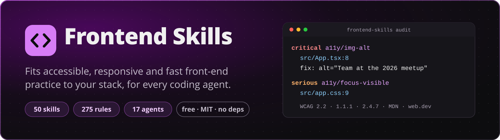

<p align="center">
  <a href="https://skills.dawidolko.pl"></a>
</p>

<p align="center">
  <strong>One command learns your front-end project, installs the matching skills into every coding agent you use, and tells you what to fix, with the rule, the line and the source.</strong>
</p>

<p align="center">
  <a href="LICENSE"></a>
  
  
  <a href="https://skills.dawidolko.pl/skills/"></a>
  <a href="https://skills.dawidolko.pl/rules/"></a>
  <a href="#supported-agents"></a>
</p>

<p align="center">
  <a href="https://skills.dawidolko.pl"><b>Website</b></a> ·
  <a href="https://skills.dawidolko.pl/rules/"><b>Rule dictionary</b></a> ·
  <a href="https://skills.dawidolko.pl/how-it-works/">How it works</a> ·
  <a href="README.pl.md">Polski</a>
</p>

---

Frontend Skills is a free, open-source dictionary of **skills** (instructions a coding agent loads when it needs them) and **rules** (one sentence each, with a stable id, a severity and a public source) for HTML, CSS, JavaScript and the frameworks built on them. The command fits that dictionary to your project: it reads your stack, installs only what applies, in the format each of your agents reads, and audits your source so you and your agent know what to change.

It helps you work towards WCAG 2.2 AA, good Lighthouse results and layouts that hold from 320 px up. Automated checks find only part of the problems; the report says which parts need a person.

## Contents

- [Quick start](#quick-start)
- [What happens](#what-happens)
- [Recordings](#recordings)
- [An example report](#an-example-report)
- [Supported agents](#supported-agents)
- [The dictionary, and how rules adapt to your project](#the-dictionary-and-how-rules-adapt-to-your-project)
- [Commands](#commands)
- [Token cost](#token-cost)
- [What automated checks cannot do](#what-automated-checks-cannot-do)
- [FAQ](#faq)
- [Contributing](#contributing)
- [Licence](#licence) · [Author](#author)

## Quick start

In the root of your front-end project (Node.js 20 or newer):

```sh
npx github:dawidolko/frontend-skills init
```

No account, no install, no build step: `npx` runs the command straight from this repository. Add `--dry-run` to see the plan without writing anything, and `uninstall` removes everything it wrote.

## What happens

1. **It learns the project.** Frameworks and their installed versions, TypeScript, styling, testing, build and lint tools, workspaces of a monorepo, a plain HTML site, and your own conventions (a px-to-rem function, an icon font, design tokens). The result is `.frontend-skills/profile.json`, which you commit.
2. **It installs the skills that fit, for every agent you use.** It finds the agents already set up in the project (or takes `--agents claude,cursor,copilot`), picks the fewest skills folders that every agent reads, writes glob-scoped rule files where an agent supports them (so a CSS rule is not loaded while you edit a test), and adds one short marked block to `AGENTS.md`, `CLAUDE.md` or `GEMINI.md`. Nothing you wrote is overwritten; every written file is recorded.
3. **It audits your source and writes a report.** Static checks run on HTML, JSX and TSX, Vue, Svelte, Astro and Angular templates, CSS, SCSS and Less. Each finding has its rule id, `file:line`, why it matters, a fix and a source. `frontend-report.md` is for you; `audit --json` is condensed for agents.

From then on your agent reads the profile and the skills before it writes front-end code, runs `audit --changed` after a change, and names rule ids in reviews.

## Recordings

Real sessions on [`fixtures/projects/react-vite`](fixtures/projects/react-vite), a small React, TypeScript and Tailwind project with a few typical mistakes. Recorded with [`tools/record.mjs`](tools/record.mjs), which runs the command, keeps its real output and timing, and draws it as an animated SVG (with reduced motion, the final screen is shown).

**`init`**: detects React 19, TypeScript and Tailwind, finds Claude Code and Cursor, installs 17 of the 26 skills into one folder both read, and runs the first audit.

<picture>
  <source media="(prefers-reduced-motion: reduce)" srcset="docs/media/init.png">
  
</picture>

**`audit`**: counts by severity, the rules found most, where the report is. The exit code is 1 because something is at `serious` or above, so CI can stop on it.

<picture>
  <source media="(prefers-reduced-motion: reduce)" srcset="docs/media/audit.png">
  
</picture>

**`explain a11y/img-alt`**: the rule in full, the same text the report, the agents and the website use.

<picture>
  <source media="(prefers-reduced-motion: reduce)" srcset="docs/media/explain.png">
  
</picture>

Static images: [init](docs/media/init.png) · [audit](docs/media/audit.png) · [explain](docs/media/explain.png).

## An example report

An excerpt of the `frontend-report.md` that the recording above wrote:

````markdown
# Front-end report

Project: `shop` · 2026-11-11 · 3 files read, 86 static rules run.

| critical | serious | moderate | minor |
| ---: | ---: | ---: | ---: |
| 2 | 3 | 3 | 5 |

**Result: findings at `serious` or above.**

Automated checks find only part of the problems; the checklist at the end needs a person.

## Critical

### `a11y/img-alt` Every img and area element has an alt attribute; a decorative image has alt="".

Why: Without alt, a screen reader announces the file name or nothing, and the image's meaning is lost; when the image fails to load, nothing replaces it.

Fix: Describe what the image says in this context (`alt="Revenue grew 20% in 2026"`), not what it looks like. For an image that only decorates, write `alt=""` so assistive technology skips it. […]

Sources: [WCAG 2.2, Understanding SC 1.1.1 Non-text Content](https://www.w3.org/WAI/WCAG22/Understanding/non-text-content.html) · [MDN, the img element (alt)](https://developer.mozilla.org/en-US/docs/Web/HTML/Reference/Elements/img) · […]

- `src/App.tsx:8`  has no alt attribute; describe it, or use alt="" if it is decorative.

## Serious

### `a11y/focus-visible` Never remove the focus outline without drawing a visible replacement for keyboard focus.
[…]
- `src/App.tsx:16` outline-none removes the focus indicator; add a focus-visible:ring-* or focus-visible:outline-* class.
- `src/app.css:9` "a:focus" removes the focus outline with no visible replacement.
````

The full report ends with what was not checked: the rules that need a rendered page (run `audit --url http://localhost:5173` for those) and the manual rules of the installed skills as a checklist.

For agents, `audit --json` prints one entry per rule and no prose beyond the fix (shortened here):

```json
{"v":1,"failOn":"serious","failed":true,"counts":{"critical":2,"serious":3,"moderate":3,"minor":5},"rules":{"a11y/img-alt":{"s":"critical","fix":"Describe what the image says in this context (alt=\"Revenue grew 20% in 2026\"), not what it looks like.","at":["src/App.tsx:8"]},"a11y/focus-visible":{"s":"serious","fix":"Style :focus-visible instead of removing focus styles: …","at":["src/App.tsx:16","src/app.css:9"]}, …}}
```

## Supported agents

Every agent gets the same skills, written once and converted to the format it documents. The formats were checked on each vendor's documentation on 2026-11-11; [`docs/agents.md`](docs/agents.md) has the sources and the limits.

| Agent | `--agents` id | Skills folder | Rules scoped to files | Always-on file |
| --- | --- | --- | --- | --- |
| Claude Code | `claude` | `.claude/skills/` | `.claude/rules/*.md` (`paths`) | `CLAUDE.md` |
| OpenAI Codex | `codex` | `.agents/skills/` | none | `AGENTS.md` |
| Cursor | `cursor` | `.agents/skills/`, `.cursor/skills/`, `.claude/skills/` | `.cursor/rules/*.mdc` (`globs`) | `AGENTS.md` |
| GitHub Copilot | `copilot` | `.github/skills/`, `.claude/skills/`, `.agents/skills/` | `.github/instructions/*.instructions.md` (`applyTo`) | `AGENTS.md` |
| Gemini CLI | `gemini` | `.agents/skills/`, `.gemini/skills/` | none | `GEMINI.md` |
| Antigravity CLI | `antigravity` | `.agents/skills/` | `.agents/rules/*.md` (`trigger: glob`) | `AGENTS.md` |
| Devin and Windsurf | `devin` (`windsurf`) | `.agents/skills/`, `.devin/skills/` | `.devin/rules/*.md` (`trigger: glob`) | `AGENTS.md` |
| OpenCode | `opencode` | `.opencode/skills/`, `.claude/skills/`, `.agents/skills/` | none | `AGENTS.md` |
| Cline | `cline` | `.cline/skills/`, `.claude/skills/` | `.clinerules/*.md` (`paths`) | `AGENTS.md` |
| Zed | `zed` | `.agents/skills/` | none | first of its list, e.g. `AGENTS.md` |
| JetBrains Junie | `junie` | `.junie/skills/`, `.agents/skills/` (trusted projects) | none | `AGENTS.md` |
| Kiro | `kiro` | `.kiro/skills/` | `.kiro/steering/*.md` (`fileMatch`) | `AGENTS.md` |
| Augment | `augment` | `.augment/skills/`, `.claude/skills/`, `.agents/skills/` | not documented | `AGENTS.md` |
| Trae | `trae` | `.trae/skills/` | `.trae/rules/*.md` (`globs`) | `AGENTS.md` (when enabled) |
| Continue | `continue` | none | `.continue/rules/*.md` (`globs`) | none |
| Amazon Q Developer | `amazonq` | none | `.amazonq/rules/*.md` (always applied) | none |
| Aider | `aider` | none | none | `CONVENTIONS.md` via `.aider.conf.yml` |

When several agents read the same folder, one copy serves them all; when a duplicate cannot be avoided (for example Cursor reads both `.agents/skills/` and `.claude/skills/`), the plan and `doctor` say so. Agents without skills get short files that point to the one copy.

## The dictionary, and how rules adapt to your project

Every rule has an id such as `a11y/img-alt`, `css/rem-helper` or `perf/lcp-image-priority`, one sentence, a severity (`critical`, `serious`, `moderate`, `minor`, the scale axe-core uses) and at least one source: WCAG 2.2 with the success criterion, WAI-ARIA Authoring Practices, the WHATWG and W3C specifications, MDN, web.dev, the framework's own docs or the W3Schools style guides. The prose is our own; the source is linked. The same id is used in skills, findings, `explain`, reviews and the [website's dictionary](https://skills.dawidolko.pl/rules/), so a person and an agent always talk about the same thing.

Today: **176 rules** in 18 areas (148 checked in the source, 1 in the browser, 27 reviewed by a person or the agent) and **26 skills** for HTML, forms, JavaScript, TypeScript, responsive layout, CSS architecture, layout and modern CSS, Sass, Tailwind, icons, motion, fonts, images, data fetching, state, React, Next.js, Vue, Nuxt, Angular, Svelte, SvelteKit, Astro and web components.

**Rules follow your project's own tools.** `init` records helpers it finds, and the rules that depend on one name it in their fix. On [`fixtures/projects/scss-helpers`](fixtures/projects/scss-helpers), which has a `rem-calc()` Sass function and a Fantasticon icon font with the prefix `ico-`, the always-on block every agent reads gets:

```markdown
### This project

- Sizes: write rem with `rem-calc()` (defined in `src/styles/_functions.scss`), not raw px.
- Icons: use the generated classes `ico-<name>`; add a new icon as an SVG in `src/icons` and rebuild (fantasticon).
- Design tokens (style-dictionary): take colours, spacing and type from `tokens/color.tokens.json`; never hard-code them.
```

and the audit speaks the project's language:

```text
minor  css/rem-helper      src/styles/main.scss:12  padding: 24px uses px; write rem-calc(24px) like the rest of the project.
minor  html/project-icons  index.html:9             This icon is an image file; use the generated class "ico-close" with aria-hidden="true".
```

Detected helpers: a px-to-rem function (`rem-calc`, `rem`, `to-rem`, `px-to-rem`…), a px-to-rem build step, an icon font or SVG sprite build, design token files and custom properties. If one was missed or is wrong, edit `profile.helpers` and set `"source": "person"`; your entry survives later runs. Lessons you confirm (`learn --lesson "…"`) go to `.frontend-skills/lessons.md`, which every skill reads first.

## Commands

All commands take `--cwd <dir>` and `--help`; output is short by default and `--json` gives machine output where it makes sense.

| Command | What it does |
| --- | --- |
| `init` | Detect the stack and the agents, write the profile, show the plan, install, run the first audit. `--agents a,b`, `--format skills\|rules\|both`, `--dry-run`, `--yes`. |
| `audit [path]` | Check the source and write `frontend-report.md`. `--changed` (only files changed against `--base`), `--json`, `--fail-on <level>`, `--url <address>` for Lighthouse and axe-core on a running page (fetched only after you agree). |
| `explain <rule id>` | The rule: why, fix, examples, sources and the skill that teaches it. |
| `list` | The skills that fit this project with their token cost; `--all` for every skill, `--rules` for the dictionary. |
| `learn` | Re-detect the stack after it changed, or record a confirmed lesson with `--lesson`. |
| `doctor` | Per agent: which files exist, whether they are current, duplicates. Exit 1 when something is missing or stale. |
| `update` | Re-install the recorded selection from the current version; files you changed are kept and listed. |
| `uninstall` | Remove exactly what the install record lists; a file you edited is kept. |
| `tokens` | The estimated token cost of what is installed. |

Exit codes of `audit`: `0` nothing at or above `--fail-on` (default `serious`), `1` something is, `2` a usage error, `3` a requested tool is not available.

## Token cost

What an agent always pays for is the list of skill names and descriptions plus the instruction block; a skill's body is loaded only when the agent uses it, and its reference file only when a step needs it. The budgets are enforced by `npm run check`: at most 400 characters per description, 1,800 tokens per `SKILL.md`, 250 tokens for the instruction block.

Measured on 2026-11-11 on `fixtures/projects/react-vite` after `init` (Claude Code and Cursor, 17 skills), with `npx github:dawidolko/frontend-skills tokens`:

| What | When it is loaded | Tokens |
| --- | --- | ---: |
| 17 skill listings + instruction block | always, per agent | ~1,538 (~1,403 + ~135) |
| one glob-scoped rule file | while a matching file is open | ~460 |
| one skill body | when the agent uses the skill | ~794 to ~1,097 |
| one reference file | when a step needs it | ~1,070 to ~2,297 |
| all 26 skill listings | if every skill were installed | ~2,102 |

The numbers come from the command's own estimator, calibrated on the o200k tokenizer (total error +0.5% on this repository's Markdown; method in [`docs/tokens.md`](docs/tokens.md)). Other models' tokenizers count somewhat differently, so use them to compare, not to predict a bill. `tokens --all` prints the cost of every skill in the package; `--format skills` is the cheapest install.

## What automated checks cannot do

The static audit reports only what the source proves; a false positive costs more trust than a missed finding. That leaves three kinds of problems:

| Found in the source (`audit`) | Needs a rendered page (`audit --url`) | Needs a person |
| --- | --- | --- |
| Missing `alt`, `lang`, title, viewport; zoom blocked; positive `tabindex`; click handlers on static elements; unlabeled fields; removed focus outlines; images without size; render-blocking scripts; fonts without `font-display`; oversized images | Colour contrast, names computed through components, landmarks and headings of the final DOM, focus order, target size, Lighthouse performance (LCP, CLS, TBT), SEO and best practices | Whether alt text says the right thing, error messages, reading order, keyboard traps in custom widgets, what a screen reader announces, cognitive load |

A clean audit does not mean a page conforms to WCAG. The report lists the manual checks of the installed skills so they are not forgotten.

## FAQ

**Does it send my code anywhere?**
No. There is no telemetry and no network call, except what you start yourself: `npx` fetching the command, and `audit --url`, which asks before it downloads Lighthouse and axe-core into a cache outside your project.

**Will it overwrite my files?**
No. Shared files such as `AGENTS.md` get one block between `<!-- frontend-skills:start -->` and `<!-- frontend-skills:end -->`; text outside it is never touched. Every file it writes is recorded with its hash, `update` skips files you changed, and `uninstall` removes only what still matches.

**Which projects does it understand?**
React, Next.js, Vue, Nuxt, Angular, Svelte, SvelteKit, Astro, web components and plain HTML sites; CSS, Sass, Less and Tailwind; npm, pnpm, Yarn, Lerna and Nx workspaces. A folder with no `package.json` is treated as a plain site.

**Can I silence a finding?**
Write `fs-ignore <rule id>` in a comment on the line or the line above, or list the id under `audit.ignore` in the profile (paths under `audit.exclude`).

**Can I run it in CI?**
Yes: `npx github:dawidolko/frontend-skills audit --changed --base origin/main --fail-on serious`. The exit code tells the job whether to fail; `--json` gives a compact result.

**Why does an agent list a skill twice?**
Some agents read more than one skills folder. The installer picks the fewest folders and warns when a duplicate is unavoidable; `--agents` with fewer agents or `--format rules` avoids it.

**Is it free?**
Yes, under the MIT licence, with no account.

## Contributing

Issues and pull requests are welcome. The command has no runtime dependencies and no build step; development uses Node.js 22 or newer.

```sh
npm ci
npm run check            # Biome, the skill and rule validator, headers, links, token estimate, all tests
node cli/index.mjs --help
```

**Adding a rule** (details and templates in [`docs/authoring.md`](docs/authoring.md)):

1. Search for an existing id first: `node cli/index.mjs list --rules`.
2. Create `rules/<area>/<name>/rule.md` with `id`, `title` (one sentence), `severity`, `check`, `applies`, at least one source from a public standard or the vendor's documentation, and the `skill` that teaches it; then `## Why`, `## Fix` and `## Examples` in your own words.
3. For `check: static`, add `check.mjs` (report only what the source proves) and `fixtures/bad.<ext>` and `fixtures/good.<ext>`; the good file holds the tricky cases the check must accept.
4. Add the id to the owning skill's `metadata.rules` and, if it matters enough, to its `## Rules` digest.
5. Run `npm run check` and never raise a budget or weaken a check to pass.

How it is built: [`docs/architecture.md`](docs/architecture.md). The website: [`docs/site.md`](docs/site.md). To record the terminal sessions again: `PLAYWRIGHT_MODULE=<path to playwright/index.mjs> node tools/record.mjs --png` (without `--png` no browser is needed). The video of the tool is rebuilt from [`media/video/`](media/video/README.md). Changes are listed in [`CHANGELOG.md`](CHANGELOG.md).

## Licence

[MIT](LICENSE).

## Author

Made by [Dawid Olko](https://dawidolko.pl). Website: [skills.dawidolko.pl](https://skills.dawidolko.pl).
