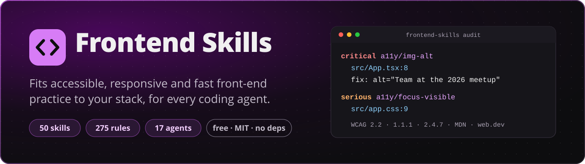

<p align="center">
  <a href="https://skills.dawidolko.pl/pl/"></a>
</p>

<p align="center">
  <strong>Jedna komenda poznaje Twój projekt front-endowy, instaluje pasujące skille w każdym agencie, którego używasz, i mówi, co poprawić: z regułą, linią i źródłem.</strong>
</p>

<p align="center">
  <a href="LICENSE"></a>
  
  
  <a href="https://skills.dawidolko.pl/pl/skills/"></a>
  <a href="https://skills.dawidolko.pl/pl/rules/"></a>
  <a href="#obsługiwani-agenci"></a>
</p>

<p align="center">
  <a href="https://skills.dawidolko.pl/pl/"><b>Strona</b></a> ·
  <a href="https://skills.dawidolko.pl/pl/rules/"><b>Słownik reguł</b></a> ·
  <a href="https://skills.dawidolko.pl/pl/how-it-works/">Jak to działa</a> ·
  <a href="README.md">English</a>
</p>

---

Frontend Skills to darmowy, otwarty słownik **skilli** (instrukcji, które agent kodujący wczytuje, gdy ich potrzebuje) i **reguł** (każda w jednym zdaniu, ze stałym identyfikatorem, wagą i publicznym źródłem) dla HTML, CSS, JavaScriptu i frameworków na nich zbudowanych. Komenda dopasowuje ten słownik do Twojego projektu: czyta stos, instaluje tylko to, co pasuje, w formacie, który czyta każdy z Twoich agentów, i sprawdza kod źródłowy, żebyś Ty i Twój agent wiedzieli, co zmienić.

Pomaga pracować w kierunku WCAG 2.2 AA, dobrych wyników w Lighthouse i układów, które trzymają się od 320 px w górę. Automatyczne testy znajdują tylko część problemów; raport mówi, które części wymagają człowieka.

Skille i reguły są po angielsku, bo czytają je agenci; wszystko wokół nich (strona, ten plik) jest też po polsku.

## Spis treści

- [Szybki start](#szybki-start)
- [Co się dzieje](#co-się-dzieje)
- [Nagrania](#nagrania)
- [Przykładowy raport](#przykładowy-raport)
- [Obsługiwani agenci](#obsługiwani-agenci)
- [Słownik i jak reguły dopasowują się do projektu](#słownik-i-jak-reguły-dopasowują-się-do-projektu)
- [Komendy](#komendy)
- [Koszt w tokenach](#koszt-w-tokenach)
- [Czego automatyczne testy nie zrobią](#czego-automatyczne-testy-nie-zrobią)
- [FAQ](#faq)
- [Jak pomóc](#jak-pomóc)
- [Licencja](#licencja) · [Autor](#autor)

## Szybki start

W katalogu głównym projektu front-endowego (Node.js 20 lub nowszy):

```sh
npx github:dawidolko/frontend-skills init
```

Bez konta, bez instalacji, bez budowania: `npx` uruchamia komendę prosto z tego repozytorium. Dodaj `--dry-run`, żeby zobaczyć plan bez zapisywania czegokolwiek, a `uninstall` usuwa wszystko, co zostało zapisane.

## Co się dzieje

1. **Poznaje projekt.** Frameworki i ich zainstalowane wersje, TypeScript, stylowanie, testy, narzędzia budowania i lintowania, pakiety monorepo, zwykłą stronę HTML i Twoje własne konwencje (funkcję px na rem, font z ikonami, design tokeny). Wynik to `.frontend-skills/profile.json`, który commitujesz.
2. **Instaluje pasujące skille dla każdego agenta, którego używasz.** Znajduje agentów już skonfigurowanych w projekcie (albo bierze `--agents claude,cursor,copilot`), wybiera najmniej folderów skilli, które czyta każdy z nich, zapisuje reguły ograniczone do typów plików tam, gdzie agent to obsługuje (reguła CSS nie jest wczytywana, gdy edytujesz test), i dodaje jeden krótki, oznaczony blok do `AGENTS.md`, `CLAUDE.md` albo `GEMINI.md`. Nic, co napisałeś, nie jest nadpisywane; każdy zapisany plik jest zapamiętany.
3. **Sprawdza kod i pisze raport.** Testy statyczne działają na HTML, JSX i TSX, szablonach Vue, Svelte, Astro i Angulara, CSS, SCSS i Less. Każde znalezisko ma identyfikator reguły, `plik:linię`, powód, poprawkę i źródło. `frontend-report.md` jest dla Ciebie; `audit --json` to zwięzła wersja dla agentów.

Od tej chwili agent czyta profil i skille, zanim napisze kod front-endu, uruchamia `audit --changed` po zmianie i podaje identyfikatory reguł w code review.

## Nagrania

Prawdziwe sesje na [`fixtures/projects/react-vite`](fixtures/projects/react-vite), małym projekcie React, TypeScript i Tailwind z kilkoma typowymi błędami. Nagrane skryptem [`tools/record.mjs`](tools/record.mjs), który uruchamia komendę, zachowuje jej prawdziwy wynik i czas, i rysuje go jako animowany SVG (przy ograniczonym ruchu widać od razu ostatni ekran).

**`init`**: wykrywa React 19, TypeScript i Tailwind, znajduje Claude Code i Cursora, instaluje 41 z 50 skilli w jednym folderze, który czytają oba, i uruchamia pierwszy audyt.

<picture>
  <source media="(prefers-reduced-motion: reduce)" srcset="https://skills.dawidolko.pl/media/init.png">
  
</picture>

**`audit`**: liczby według wagi, najczęstsze reguły, gdzie jest raport. Kod wyjścia to 1, bo coś ma wagę `serious` lub wyższą, więc CI może się na tym zatrzymać.

<picture>
  <source media="(prefers-reduced-motion: reduce)" srcset="https://skills.dawidolko.pl/media/audit.png">
  
</picture>

**`explain a11y/img-alt`**: cała reguła, ten sam tekst, którego używają raport, agenci i strona.

<picture>
  <source media="(prefers-reduced-motion: reduce)" srcset="https://skills.dawidolko.pl/media/explain.png">
  
</picture>

Obrazy statyczne: [init](https://skills.dawidolko.pl/media/init.png) · [audit](https://skills.dawidolko.pl/media/audit.png) · [explain](https://skills.dawidolko.pl/media/explain.png).

## Przykładowy raport

Fragment pliku `frontend-report.md`, który zapisało powyższe nagranie (raport jest po angielsku, jak reguły):

````markdown
# Front-end report

Project: `shop` · 2026-11-11 · 3 files read, 131 static rules run.

| critical | serious | moderate | minor |
| ---: | ---: | ---: | ---: |
| 2 | 3 | 4 | 5 |

**Result: findings at `serious` or above.**

Automated checks find only part of the problems; the checklist at the end needs a person.

## Critical

### `a11y/img-alt` Every img and area element has an alt attribute; a decorative image has alt="".

Why: Without alt, a screen reader announces the file name or nothing, and the image's meaning is lost; when the image fails to load, nothing replaces it.

Fix: Describe what the image says in this context (`alt="Revenue grew 20% in 2026"`), not what it looks like. For an image that only decorates, write `alt=""` so assistive technology skips it. […]

Sources: [WCAG 2.2, Understanding SC 1.1.1 Non-text Content](https://www.w3.org/WAI/WCAG22/Understanding/non-text-content.html) · [MDN, the img element (alt)](https://developer.mozilla.org/en-US/docs/Web/HTML/Reference/Elements/img) · […]

- `src/App.tsx:8`  has no alt attribute; describe it, or use alt="" if it is decorative.

## Serious

### `a11y/focus-visible` Never remove the focus outline without drawing a visible replacement for keyboard focus.
[…]
- `src/App.tsx:16` outline-none removes the focus indicator; add a focus-visible:ring-* or focus-visible:outline-* class.
- `src/app.css:9` "a:focus" removes the focus outline with no visible replacement.
````

Pełny raport kończy się tym, czego nie sprawdzono: regułami, które potrzebują wyrenderowanej strony (dla nich `audit --url http://localhost:5173`), i regułami ręcznymi zainstalowanych skilli w formie listy kontrolnej.

Dla agentów `audit --json` wypisuje jeden wpis na regułę i żadnej prozy poza poprawką (tu skrócone):

```json
{"v":1,"failOn":"serious","failed":true,"counts":{"critical":2,"serious":3,"moderate":4,"minor":5},"rules":{"a11y/img-alt":{"s":"critical","fix":"Describe what the image says in this context (alt=\"Revenue grew 20% in 2026\"), not what it looks like.","at":["src/App.tsx:8"]},"a11y/focus-visible":{"s":"serious","fix":"Style :focus-visible instead of removing focus styles: …","at":["src/App.tsx:16","src/app.css:9"]}, …}}
```

## Obsługiwani agenci

Każdy agent dostaje te same skille, napisane raz i zamienione na format, który opisuje jego dokumentacja. Formaty sprawdzono w dokumentacji każdego producenta 11 listopada 2026; źródła i limity są w [`docs/agents.md`](docs/agents.md).

| Agent | id w `--agents` | Folder skilli | Reguły ograniczone do plików | Plik zawsze wczytywany |
| --- | --- | --- | --- | --- |
| Claude Code | `claude` | `.claude/skills/` | `.claude/rules/*.md` (`paths`) | `CLAUDE.md` |
| OpenAI Codex | `codex` | `.agents/skills/` | brak | `AGENTS.md` |
| Cursor | `cursor` | `.agents/skills/`, `.cursor/skills/`, `.claude/skills/` | `.cursor/rules/*.mdc` (`globs`) | `AGENTS.md` |
| GitHub Copilot | `copilot` | `.github/skills/`, `.claude/skills/`, `.agents/skills/` | `.github/instructions/*.instructions.md` (`applyTo`) | `AGENTS.md` |
| Gemini CLI | `gemini` | `.agents/skills/`, `.gemini/skills/` | brak | `GEMINI.md` |
| Antigravity CLI | `antigravity` | `.agents/skills/` | `.agents/rules/*.md` (`trigger: glob`) | `AGENTS.md` |
| Devin i Windsurf | `devin` (`windsurf`) | `.agents/skills/`, `.devin/skills/` | `.devin/rules/*.md` (`trigger: glob`) | `AGENTS.md` |
| OpenCode | `opencode` | `.opencode/skills/`, `.claude/skills/`, `.agents/skills/` | brak | `AGENTS.md` |
| Cline | `cline` | `.cline/skills/`, `.claude/skills/` | `.clinerules/*.md` (`paths`) | `AGENTS.md` |
| Zed | `zed` | `.agents/skills/` | brak | pierwszy z jego listy, np. `AGENTS.md` |
| JetBrains Junie | `junie` | `.junie/skills/`, `.agents/skills/` (zaufane projekty) | brak | `AGENTS.md` |
| Kiro | `kiro` | `.kiro/skills/` | `.kiro/steering/*.md` (`fileMatch`) | `AGENTS.md` |
| Augment | `augment` | `.augment/skills/`, `.claude/skills/`, `.agents/skills/` | nieudokumentowane | `AGENTS.md` |
| Trae | `trae` | `.trae/skills/` | `.trae/rules/*.md` (`globs`) | `AGENTS.md` (po włączeniu) |
| Continue | `continue` | brak | `.continue/rules/*.md` (`globs`) | brak |
| Amazon Q Developer | `amazonq` | brak | `.amazonq/rules/*.md` (zawsze stosowane) | brak |
| Aider | `aider` | brak | brak | `CONVENTIONS.md` przez `.aider.conf.yml` |

Gdy kilku agentów czyta ten sam folder, jedna kopia służy wszystkim; gdy duplikatu nie da się uniknąć (na przykład Cursor czyta i `.agents/skills/`, i `.claude/skills/`), mówią o tym plan i `doctor`. Agenci bez skilli dostają krótkie pliki, które wskazują na tę jedną kopię.

## Słownik i jak reguły dopasowują się do projektu

Każda reguła ma identyfikator, na przykład `a11y/img-alt`, `css/rem-helper` albo `perf/lcp-image-priority`, jedno zdanie, wagę (`critical`, `serious`, `moderate`, `minor`, ta sama skala co w axe-core) i co najmniej jedno źródło: WCAG 2.2 z numerem kryterium sukcesu, WAI-ARIA Authoring Practices, specyfikacje WHATWG i W3C, MDN, web.dev, dokumentację frameworka albo przewodniki stylu W3Schools. Tekst jest nasz własny; źródło jest podlinkowane. Ten sam identyfikator pojawia się w skillach, znaleziskach, `explain`, code review i w [słowniku na stronie](https://skills.dawidolko.pl/pl/rules/), więc człowiek i agent zawsze mówią o tym samym.

Dziś: **275 reguł** w 23 obszarach (195 sprawdzanych w kodzie, 19 w przeglądarce, 61 do przejrzenia przez człowieka albo agenta) i **50 skilli**: dostępność (podstawy, ARIA, klawiatura, formularze, okna dialogowe, menu, zakładki i akordeony, comboboxy, tabele, multimedia, karuzele i powiadomienia, warstwa wizualna), podstawy (HTML, formularze, JavaScript, TypeScript, układy responsywne), stylowanie (architektura CSS, layout, nowoczesny CSS, Sass, Tailwind, ikony, animacje), wydajność (Core Web Vitals, Lighthouse, dostarczanie, fonty, obrazy), jakość (bezpieczeństwo, metadane SEO, internacjonalizacja, testy, narzędzia), frameworki (React, Next.js, Vue, Nuxt, Angular, Svelte, SvelteKit, Astro, web components, pobieranie danych, stan) i praca (audyt, poprawki, review, nauka projektu, komponenty).

**Reguły używają narzędzi Twojego projektu.** `init` zapisuje znalezione helpery, a reguły, które od nich zależą, podają je w poprawce. Na [`fixtures/projects/scss-helpers`](fixtures/projects/scss-helpers), gdzie jest funkcja Sass `rem-calc()` i font z ikonami z Fantasticona z prefiksem `ico-`, blok wczytywany przez każdego agenta dostaje:

```markdown
### This project

- Sizes: write rem with `rem-calc()` (defined in `src/styles/_functions.scss`), not raw px.
- Icons: use the generated classes `ico-<name>`; add a new icon as an SVG in `src/icons` and rebuild (fantasticon).
- Design tokens (style-dictionary): take colours, spacing and type from `tokens/color.tokens.json`; never hard-code them.
```

a audyt mówi językiem projektu:

```text
minor  css/rem-helper      src/styles/main.scss:12  padding: 24px uses px; write rem-calc(24px) like the rest of the project.
minor  html/project-icons  index.html:9             This icon is an image file; use the generated class "ico-close" with aria-hidden="true".
```

Wykrywane helpery: funkcja px na rem (`rem-calc`, `rem`, `to-rem`, `px-to-rem`…), krok budowania zamieniający px na rem, font z ikonami albo sprite SVG, pliki design tokenów i custom properties. Jeśli któregoś brakuje albo jest błędny, popraw `profile.helpers` i ustaw `"source": "person"`; Twój wpis przetrwa kolejne uruchomienia. Lekcje, które potwierdzisz (`learn --lesson "…"`), trafiają do `.frontend-skills/lessons.md`, który każdy skill czyta jako pierwszy.

## Komendy

Każda komenda przyjmuje `--cwd <katalog>` i `--help`; wynik jest domyślnie krótki, a `--json` daje wynik dla maszyn tam, gdzie ma to sens.

| Komenda | Co robi |
| --- | --- |
| `init` | Wykrywa stos i agentów, zapisuje profil, pokazuje plan, instaluje, uruchamia pierwszy audyt. `--agents a,b`, `--format skills\|rules\|both`, `--dry-run`, `--yes`. |
| `audit [ścieżka]` | Sprawdza kod i zapisuje `frontend-report.md`. `--changed` (tylko pliki zmienione względem `--base`), `--json`, `--fail-on <waga>`, `--url <adres>` dla Lighthouse i axe-core na działającej stronie (pobierane dopiero po Twojej zgodzie). |
| `explain <id reguły>` | Reguła: powód, poprawka, przykłady, źródła i skill, który jej uczy. |
| `list` | Skille pasujące do projektu z kosztem w tokenach; `--all` dla wszystkich, `--rules` dla słownika. |
| `learn` | Wykrywa stos ponownie po zmianie albo zapisuje potwierdzoną lekcję przez `--lesson`. |
| `doctor` | Dla każdego agenta: które pliki są, czy są aktualne, duplikaty. Kod wyjścia 1, gdy czegoś brakuje albo jest nieaktualne. |
| `update` | Instaluje zapisany wybór z bieżącej wersji; pliki, które zmieniłeś, zostają i są wypisane. |
| `uninstall` | Usuwa dokładnie to, co jest w zapisie instalacji; plik, który edytowałeś, zostaje. |
| `tokens` | Szacowany koszt w tokenach tego, co jest zainstalowane. |

Kody wyjścia `audit`: `0` nic na poziomie `--fail-on` lub wyżej (domyślnie `serious`), `1` coś jest, `2` błąd użycia, `3` potrzebne narzędzie jest niedostępne.

## Koszt w tokenach

Agent zawsze płaci za listę nazw i opisów skilli oraz blok instrukcji; treść skilla jest wczytywana dopiero, gdy agent go używa, a plik referencyjny dopiero, gdy potrzebuje go konkretny krok. Budżety pilnuje `npm run check`: najwyżej 400 znaków na opis, 1800 tokenów na `SKILL.md`, 250 tokenów na blok instrukcji.

Zmierzone 11 listopada 2026 na `fixtures/projects/react-vite` po `init` (Claude Code i Cursor, 41 skilli) komendą `npx github:dawidolko/frontend-skills tokens`:

| Co | Kiedy jest wczytywane | Tokeny |
| --- | --- | ---: |
| 41 opisów skilli + blok instrukcji | zawsze, w każdym agencie | ~3655 (~3520 + ~135) |
| jeden plik reguł ograniczony do plików | gdy otwarty jest pasujący plik | ~460 |
| treść jednego skilla | gdy agent używa skilla | od ~670 do ~1127 |
| jeden plik referencyjny | gdy potrzebuje go krok | od ~731 do ~2711 |
| opisy wszystkich 50 skilli | gdyby zainstalować wszystkie | ~4219 |

Liczby pochodzą z estymatora samej komendy, skalibrowanego na tokenizerze o200k (łączny błąd +0,5% na Markdownie tego repozytorium; metoda w [`docs/tokens.md`](docs/tokens.md)). Tokenizery innych modeli liczą trochę inaczej, więc służą do porównań, nie do przewidywania rachunku. `tokens --all` wypisuje koszt każdego skilla w pakiecie; `--format skills` to najtańsza instalacja.

## Czego automatyczne testy nie zrobią

Audyt statyczny zgłasza tylko to, czego dowodzi kod źródłowy; fałszywy alarm kosztuje więcej zaufania niż przeoczone znalezisko. Zostają trzy rodzaje problemów:

| Znalezione w kodzie (`audit`) | Potrzebują wyrenderowanej strony (`audit --url`) | Potrzebują człowieka |
| --- | --- | --- |
| Brak `alt`, `lang`, tytułu, viewportu; zablokowany zoom; dodatni `tabindex`; obsługa kliknięcia na elementach statycznych; pola bez etykiet; usunięty obrys fokusu; obrazy bez wymiarów; skrypty blokujące renderowanie; fonty bez `font-display`; za duże obrazy | Kontrast kolorów, nazwy liczone przez komponenty, landmarki i nagłówki w końcowym DOM, kolejność fokusu, rozmiar celu, wydajność w Lighthouse (LCP, CLS, TBT), SEO i dobre praktyki | Czy tekst alternatywny mówi to, co trzeba, komunikaty błędów, kolejność czytania, pułapki klawiatury we własnych widżetach, co odczytuje czytnik ekranu, obciążenie poznawcze |

Czysty audyt nie znaczy, że strona jest zgodna z WCAG. Raport wypisuje ręczne kontrole zainstalowanych skilli, żeby o nich nie zapomnieć.

## FAQ

**Czy wysyła gdzieś mój kod?**
Nie. Nie ma telemetrii ani połączeń sieciowych poza tymi, które sam uruchamiasz: `npx` pobierającym komendę i `audit --url`, który pyta, zanim pobierze Lighthouse i axe-core do pamięci podręcznej poza projektem.

**Czy nadpisze moje pliki?**
Nie. Wspólne pliki, takie jak `AGENTS.md`, dostają jeden blok między `<!-- frontend-skills:start -->` a `<!-- frontend-skills:end -->`; tekst poza nim nie jest ruszany. Każdy zapisany plik jest zapamiętany z hashem, `update` pomija pliki, które zmieniłeś, a `uninstall` usuwa tylko to, co się nadal zgadza.

**Jakie projekty rozumie?**
React, Next.js, Vue, Nuxt, Angular, Svelte, SvelteKit, Astro, web components i zwykłe strony HTML; CSS, Sass, Less i Tailwind; pakiety npm, pnpm, Yarn, Lerna i Nx. Folder bez `package.json` jest traktowany jak zwykła strona.

**Czy mogę wyciszyć znalezisko?**
Napisz `fs-ignore <id reguły>` w komentarzu w tej linii albo linię wyżej, albo dodaj identyfikator do `audit.ignore` w profilu (ścieżki do `audit.exclude`).

**Czy mogę uruchamiać to w CI?**
Tak: `npx github:dawidolko/frontend-skills audit --changed --base origin/main --fail-on serious`. Kod wyjścia mówi zadaniu, czy ma się nie udać; `--json` daje zwięzły wynik.

**Dlaczego agent pokazuje skill dwa razy?**
Niektórzy agenci czytają więcej niż jeden folder skilli. Instalator wybiera najmniej folderów i ostrzega, gdy duplikatu nie da się uniknąć; mniej agentów w `--agents` albo `--format rules` go usuwa.

**Czy to jest darmowe?**
Tak, na licencji MIT, bez konta.

## Jak pomóc

Zgłoszenia i pull requesty są mile widziane. Komenda nie ma zależności w działaniu ani kroku budowania; do pracy nad nią potrzebny jest Node.js 22 lub nowszy.

```sh
npm ci
npm run check            # Biome, walidator skilli i reguł, nagłówki, linki, szacowanie tokenów, wszystkie testy
node cli/index.mjs --help
```

**Dodanie reguły** (szczegóły i szablony w [`docs/authoring.md`](docs/authoring.md), po angielsku):

1. Najpierw poszukaj istniejącego identyfikatora: `node cli/index.mjs list --rules`.
2. Utwórz `rules/<obszar>/<nazwa>/rule.md` z `id`, `title` (jedno zdanie), `severity`, `check`, `applies`, co najmniej jednym źródłem z publicznego standardu albo dokumentacji producenta i `skill`, który jej uczy; potem `## Why`, `## Fix` i `## Examples` własnymi słowami.
3. Dla `check: static` dodaj `check.mjs` (zgłaszaj tylko to, czego dowodzi kod) oraz `fixtures/bad.<rozszerzenie>` i `fixtures/good.<rozszerzenie>`; dobry plik zawiera trudne przypadki, które test musi przepuścić.
4. Dodaj identyfikator do `metadata.rules` skilla, który jest jej właścicielem, a jeśli jest dość ważna, do jego sekcji `## Rules`.
5. Uruchom `npm run check` i nigdy nie podnoś budżetu ani nie osłabiaj testu, żeby przeszedł.

Jak to jest zbudowane: [`docs/architecture.md`](docs/architecture.md).

## Licencja

[MIT](LICENSE).

## Autor

Autor: [Dawid Olko](https://dawidolko.pl). Strona: [skills.dawidolko.pl](https://skills.dawidolko.pl/pl/).
